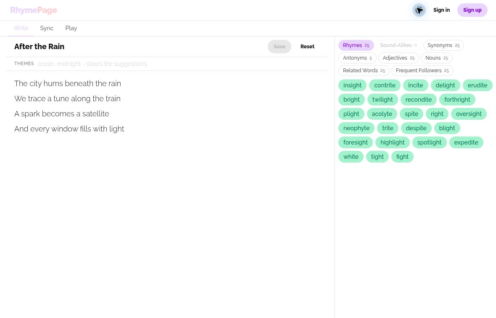
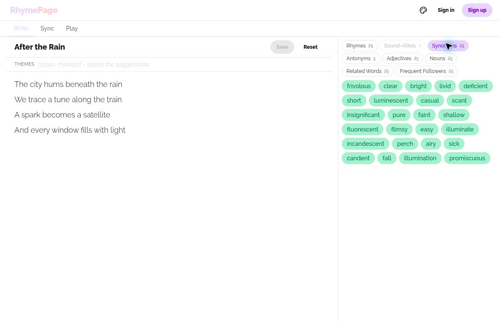

# RhymePage

### Keep the next word within reach.

A browser workspace for writing lyrics, exploring word relationships, and keeping song ideas together. RhymePage puts suggestions beside the line you're working on, with definitions, theme filters, and a saved notebook a few clicks away.

**[Open RhymePage](https://rhymepage.com/) · [Writing controls](#writing-controls) · [Word categories](#eight-ways-to-find-the-next-word) · [Run locally](#run-locally)**



*The writing workspace, shown with an original sample verse. The category counts and word chips are actual site results, which can vary between searches.*

## From a line to a new direction

| Write | Explore | Keep building |
| --- | --- | --- |
| Finish a word with **Space** or **Enter**. | Switch between rhymes, synonyms, adjectives, and other relationships. | Insert a suggestion where you're editing, then save the idea to your notebook. |
| Lookup follows the word immediately before your cursor. | Add a theme to steer the results toward the subject of your song. | Pin and tag saved notes so you can return to a draft. |

You can try the writing workspace without signing in. Saving notes, account preferences, and notebook features require an account. Lyric timing and playback are being developed in the **Sync** and **Play** tabs; see their current scope below.

## Writing controls

| Control | What it does | Useful when |
| --- | --- | --- |
| **Space / Enter** in Lyrics | Looks up the completed word immediately before the caret. | Revising an earlier line without moving to the end of the song. |
| **Click / tap a word** | Inserts it at the caret, or replaces selected text, then returns focus to the editor. | Trying a suggestion without copying and pasting. |
| **Right-click / long-press a word** | Opens its dictionary definition, with parts of speech and examples when available. | Checking that a promising sound also has the right meaning. |
| **Category tabs** | Changes the relationship being displayed. Counts show how many results came back. | Moving from sound to meaning or finding a descriptive word. |
| **Themes** | Steers suggestions using topic words such as `ocean, midnight`. | Keeping a verse's imagery connected. |
| **Save** | Creates a new notebook entry or updates the current saved note. Subsequent edits use a two-second autosave debounce. | Keeping a draft after the initial save. |
| **Reset** | Clears the current editor and its note association. | Starting another idea. It does not delete a previously saved note. |
| **Mobile suggestion handle** | Cycles the suggestion sheet through peek, half-height, and full-height views. | Balancing writing space with a larger word list on a phone. |

## Eight ways to find the next word



*Changing the category keeps the verse in place and changes the kind of words you explore.*

| Category | Relationship | Writing use |
| --- | --- | --- |
| **Rhymes** | Perfect rhymes | Find an ending that fits the line's sound. |
| **Sound-Alikes** | Near rhymes | Loosen the rhyme without abandoning the sound. |
| **Synonyms** | Similar meanings | Rephrase an idea or change its register. |
| **Antonyms** | Opposite meanings | Introduce contrast. |
| **Adjectives** | Adjectives commonly used with the queried noun | Add detail to an image. |
| **Nouns** | Nouns commonly described by the queried adjective | Find something a description could refer to. |
| **Related Words** | Words often appearing near the query | Branch into nearby imagery and associations. |
| **Frequent Followers** | Words often following the query | Explore what could come next in a phrase. |

Results come from [Datamuse](https://www.datamuse.com/api/). Some relationships naturally return fewer words or none at all. Empty category tabs are disabled, and a stricter theme filter can narrow the list further.

### Tune the suggestions

The dashboard settings let signed-in writers choose which categories to fetch and how strongly themes influence them.

| Setting | Choices | Effect |
| --- | --- | --- |
| **Categories** | Enable or disable each of the eight relationships | Keeps the panel focused on the kinds of help you use. |
| **Theme mode** | **Broad** or **Specific** | Broad uses Datamuse topic hints; Specific uses its meaning constraint for a tighter semantic match. |
| **Results per category** | **5–50**, in steps of five | Controls the requested size of each result list. |

Choose **Save preferences** to apply your changes. Defaults are all eight categories, Broad mode, and 25 results per category. A request for 25 results does not guarantee that the API has 25 matches.

## A notebook for unfinished songs

Saved ideas live in **My notes**, with a separate **Shared with me** view for notes another account has shared with you.

| Action | Notebook behavior |
| --- | --- |
| **New note** | Creates a saved blank note and opens its editor. |
| **Pin** | Keeps a note above unpinned entries. |
| **Tags & sharing** | Adds tags and manages access from one dialog. |
| **Filter by tag** | Narrows the visible notebook to a subject or working group. |
| **Share by email** | Looks up an existing RhymePage account and adds it to the note's collaborator list. |
| **Remove collaborator** | Removes that account from the note's sharing list. |
| **Delete** | Deletes a note after confirmation. |

Tags are trimmed, normalized to lowercase, and deduplicated. The data model separates ownership from the collaborator list. Shared editing is an area to validate carefully as the notebook workflow develops; this is not a claim of conflict-free, simultaneous collaboration.

## In development: Sync and Play

The repository includes a growing lyric-timing workflow. Integration and end-to-end verification are still in progress, so treat this section as a guide to the controls present in the code rather than a promise that every path is production-ready.

**Save a note → mark its timing → review playback → export timing data**

| Stage | Controls present | Purpose |
| --- | --- | --- |
| **Fast sync** | Start/Pause, Mark, Finish, Replay, Undo; Space to mark and R to replay | Step through lyric lines while assigning timing. |
| **Audio** | Attach, replace, or remove an audio file | Use a recording as the timing reference. Removing it keeps the lyric timing. |
| **Precision editor** | Audio-backed waveform editing | Adjust line timing visually after a first pass. |
| **Word timing** | Words control on a timed line | Add more detailed timing within a line. |
| **Review** | Warnings and unmatched-line review | Reconcile timing when the written lyrics change. |
| **Play** | Simple, Karaoke, Teleprompter; play/pause/reset | Preview the same timing in different reading layouts. |
| **Presentation** | Hold, Clear, or Preview between lines; Mirror in Teleprompter | Choose which line stays highlighted during gaps; Mirror flips the lyric display. |
| **Export** | LRC and JSON | Download line-start lyrics or richer timing data, including word timing when present. |

Sync requires a signed-in account and a saved note. The precision editor needs attached audio. Playback can also use the saved timing without an audio attachment. Timing is manually authored; automatic audio-to-lyric alignment is not established as a finished feature here.

## How the app is built

RhymePage is a client-rendered React application. The browser handles editing and presentation, external word APIs supply suggestions and definitions, and Firebase supports account-backed data.

| Layer | Technology | Responsibility |
| --- | --- | --- |
| **Interface** | React 19 + TypeScript | Editor, word chips, notebook, settings, and timing views. |
| **Routing** | React Router 7 | Writing, notes, account, settings, and profile routes. Main pages are lazy-loaded. |
| **Styling** | Tailwind CSS 4 + in-house design tokens and `rp-*` components | Six selectable themes, responsive layouts, and the mobile suggestion sheet. No UI kit. |
| **Mobile apps** | Capacitor 8 (Android, iOS) | Native shells around the same web build, with native Google sign-in, recovery storage, and export on Android. |
| **Build** | Vite 7 | Development server and production bundle; CSS code splitting is enabled. |
| **Identity** | Firebase Authentication | Email/password and Google sign-in, plus account persistence choices. |
| **Saved data** | Cloud Firestore | Notes, preferences, profile records, sharing metadata, and lyric timing. |
| **Audio storage** | Firebase Storage | Attached recordings for the developing sync workflow. |
| **Word services** | Datamuse + Free Dictionary API | Relationship searches and English definitions using browser `fetch`. |
| **Waveform editing** | WaveSurfer.js 7 | Audio visualization in the precision editor. |
| **Checks** | TypeScript, ESLint, Vitest | Type checking, linting, and focused tests for lyric/timing utilities. |

### A lookup's path through the app

1. The editor identifies the completed word before the caret.
2. `useDashboardLogic` waits 250 ms, then requests enabled categories in parallel.
3. `rhymeApi` translates each category and theme mode into Datamuse parameters.
4. Results populate the suggestion panel. Changing the query cancels stale requests.
5. Picking a word updates the same editor state used by manual typing and note saving.

Definition lookup is separate from suggestion lookup. A missing dictionary entry and a service failure have distinct UI states.

<details>
<summary><strong>Source map and data layout</strong></summary>

| Area | Start here |
| --- | --- |
| App routes | [`src/App.tsx`](src/App.tsx) |
| Writing state and autosave | [`src/hooks/useDashboardLogic.tsx`](src/hooks/useDashboardLogic.tsx) |
| Category mapping | [`src/utils/rhymeApi.ts`](src/utils/rhymeApi.ts) |
| Suggestions and definition gestures | [`src/components/SuggestionPanel.tsx`](src/components/SuggestionPanel.tsx) |
| Notebook and sharing | [`src/hooks/useNotesLogic.tsx`](src/hooks/useNotesLogic.tsx), [`src/utils/notesApi.ts`](src/utils/notesApi.ts) |
| Sync and playback | [`src/components/SyncPanel.tsx`](src/components/SyncPanel.tsx), [`src/components/PlayPanel.tsx`](src/components/PlayPanel.tsx) |
| Timing export | [`src/utils/syncExport.ts`](src/utils/syncExport.ts) |
| Themes and design system | [`src/styles/tokens.css`](src/styles/tokens.css), [`src/styles/components.css`](src/styles/components.css), [`src/theme/`](src/theme/), [`DESIGN.md`](DESIGN.md) |
| Firebase initialization | [`src/firebase.ts`](src/firebase.ts) |
| Backend access rules | [`firestore.rules`](firestore.rules), [`storage.rules`](storage.rules) |

Notes use top-level `notes/{noteId}` documents with ownership and sharing fields. Timing lives beneath a note in its `sync` subcollection. User preferences live in `users/{uid}`; public-facing profiles and email lookup use separate collections.

</details>

## Design system

The interface is built on in-house tokens and components, not a UI kit. `src/styles/tokens.css` defines six themes (Coral, Lemon, Sky, Mint, Grape, Night) plus fixed suggestion-category colours as semantic roles; `src/styles/components.css` holds the `rp-*` component classes; `src/theme/` holds the theme registry and provider. Settings > Appearance switches themes, and Auto follows the device. The design direction lives in `PRODUCT.md` and `.impeccable/surfaces/src-app-tsx.md`.

## Run locally

You will need Git, npm, and a Node.js version supported by the locked Vite/tooling dependencies. Use your own Firebase project or the local emulator suite for development.

```bash
git clone https://github.com/Arrangedgodly/RhymePage.git
cd RhymePage
npm ci
```

### Configure Firebase before using account-backed features

The checked-in Firebase web configuration and project alias point at the existing RhymePage project. They are not a ready-made development backend for a new clone.

1. Update `src/firebase.ts` with the web configuration for a Firebase project you control.
2. Configure the authentication providers you plan to use: email/password and/or Google. Set the appropriate authorized development domains in that project.
3. Provision Firestore and, if testing attached audio, Storage. Review this repository's rules and indexes before applying them to your own project.
4. Update `.firebaserc` before using Firebase CLI commands. Check the selected project before any deployment.

The current source reads the web configuration directly from `src/firebase.ts`; it does not implement a general `VITE_FIREBASE_*` environment-variable setup.

For the existing local-emulator connection path, set this in `.env.local`:

```dotenv
VITE_USE_FIREBASE_EMULATOR=true
```

With the Firebase CLI and its emulator prerequisites installed, start Auth, Firestore, and Storage emulators for your selected development project, then start Vite in another terminal:

```bash
firebase emulators:start --only auth,firestore,storage --project YOUR_PROJECT_ID
npm run dev
```

The app's emulator connection is development-only and expects Auth on 9099, Firestore on 8080, and Storage on 9199. The flag is an explicit opt-in; leaving it unset does not isolate writes from the configured backend. Word and dictionary searches still call external APIs.

### Commands

| Command | What it checks or runs |
| --- | --- |
| `npm run dev` | Vite development server. |
| `npm run build` | TypeScript check, then the production build in `dist/`. |
| `npm run preview` | Local preview of an existing production build. |
| `npm run lint` | ESLint over `src`, with zero warnings allowed. |
| `npm test` | Vitest test run. |
| `npm run legal:build` | Regenerate the static privacy and account-deletion pages (also runs before `build`). |
| `npm run android:debug` | Build, sync, and compile the Android debug APK with JDK 21. |
| `npm run android:bundle` | Build a signed AAB using private signing environment variables. |
| `npm run android:release-check` | Check local privacy/configuration/signing prerequisites separately from building. |
| `npm run ios:sync` / `ios:open` | Build the mobile web bundle into `ios/`, then open it in Xcode (macOS). |

Firebase Hosting is configured to serve `dist/` with a single-page-app rewrite. A successful frontend build alone does not configure authentication, deploy backend rules, or validate account and audio workflows.

## Mobile apps

### iOS development

The Capacitor iOS project is in `ios/` (bundle ID `com.rhymepage.app`, Swift Package Manager, iOS 15+). It ships the same mobile web build as Android.

```sh
npm install
npm run ios:sync   # build the mobile web bundle and copy it into ios/
npm run ios:open   # open the project in Xcode (macOS only)
```

Building and signing need a Mac with Xcode and an Apple Developer team selected under Signing & Capabilities. `npm run ios:art` regenerates the app icon and launch splash from the RF09 kit. On iOS, Google sign-in shows a "not available yet" message and email/password works; a native iOS Google credential bridge, LRC/JSON export through the share sheet, and recovery storage backed by native disk are still to do (the Android `RhymePage` plugin covers these on Android).

### Android development

For signed internal-testing updates, see [the version-2 AAB handoff](docs/android/internal-testing-v2.md). [CLI uploads with Fastlane](docs/android/cli-uploads.md) documents the `play:setup`, `play:check`, and `play:upload` commands and the one-time Google Play API permissions.

The public [privacy policy](https://rhymepage.com/privacy) and [account-deletion request page](https://rhymepage.com/delete-account) are available for Play Console. They are generated from the same legal-page component with `npm run legal:build`, which also runs before web builds. The owner decided against the previously considered Bubblewrap migration; continue the Capacitor app.

The Capacitor 8 Android project is in `android/`. The owner confirmed `com.rhymepage.app` as its permanent application ID. It uses the existing Firebase project and accounts.

```sh
npm install
npm run android:sync
npm run android:debug
npm run android:open
```

`android:sync` builds the web app into `dist-android/` and copies it into the native project. The standard Android build excludes the speech model, Sherpa runtime, and old Whisper prototype assets. It offers manual and waveform timing without microphone permissions. Original files in `public/` and the web alignment feature remain available. Re-run sync after web changes. The existing web build still uses `npm run build`.

Native compilation uses JDK 21, Android SDK 36, Gradle 8.14.3, and Android Gradle Plugin 8.13.0. Set `JAVA_HOME` to your JDK 21 installation and `ANDROID_HOME` to your SDK before running `android:debug`. This command builds and syncs the web app, checks Java, and compiles `android/app/build/outputs/apk/debug/app-debug.apk`. Android Studio's bundled Java may be a different version; select JDK 21 for its Gradle JVM too. Machine-specific SDK settings belong in the ignored `android/local.properties`. Signing keys must stay out of Git.

Use npm and `package-lock.json` for the current build path, matching CI. The pre-existing pnpm files are preserved, but their lockfile lacks Capacitor and is not validated for Android installs. Do not alternate package managers against the same `node_modules`.

The debug APK has compiled and run on an Android 16 emulator. Disposable Firebase emulator accounts exercised saved notes, audio upload/playback, waveform/manual timing, native LRC/JSON exports, and account deletion. Writing and pending timing have account-scoped recovery copies; Android confirms native disk commits before reporting a device save. Cloud edits use revision checks and explicit recovery choices. Android Google sign-in uses Credential Manager and the existing JavaScript Firebase Auth session. Its Firebase registration and debug certificates are configured; native Google UI launch/cancellation passed, while a completed sign-in and real UID continuity remain unverified. Candidate launcher/splash and Play artwork are included.

Backend Functions, rules, and TTL configuration must be reviewed and deployed together before distributing this client: its safe note-creation transactions and complete deletion calls require that backend update. A signed internal-testing AAB is prepared; nothing has been deployed or uploaded to Play. Physical-device acceptance, real Google sign-in, Play app-signing configuration, privacy review, and Console setup remain required. See the [current development evidence](docs/android/development-validation.md), [backend/signing handoff](docs/android/backend-and-signing.md), and [Play preparation packet](docs/android/play-preparation.md).

The local `/privacy` and `/delete-account` pages use the owner-approved public contact `Help@arrangedgodly.com`. They become public only when the coordinated website update is published.

To rebuild the signed internal-testing bundle in PowerShell, run `./scripts/build-android-bundle.ps1`. It prompts privately for the upload-keystore password and writes `android/app/build/outputs/bundle/release/rhymepage-upload.aab`. The private key stays outside the checkout. `npm run android:bundle` is the underlying Gradle bundle build; `npm run android:release-check` separately checks local privacy/configuration/signing prerequisites. Creating a bundle does not approve submission or activate the backend. See the [internal-testing upload handoff](docs/android/internal-testing-upload.md).

## Current boundaries

- Suggestions and definitions depend on external services and their current availability, limits, and terms.
- Writing is kept as a recovery copy on the device as you type, and in your notebook once saved. A device copy is not a backup; save important work to an account-backed note.
- Existing-note autosave is debounced and depends on a successful backend write. Cloud edits use revision checks and explicit recovery choices; real-time collaborative merging should not be assumed.
- Datamuse has announced that API keys will be required starting February 1, 2027; this checkout currently makes unauthenticated requests.
- Sync and Play are active development areas. Test the complete audio, timing, permissions, and playback flow before relying on them for a finished performance.
- The included tests focus on lyric parsing, sync status/diff behavior, and export formatting. They are not a substitute for browser and backend integration tests.

## Credits

Built by [Graydon Wasil / Arranged Godly](https://github.com/Arrangedgodly).

Word relationships are powered by [Datamuse](https://www.datamuse.com/api/). Definitions come from the [Free Dictionary API](https://dictionaryapi.dev/).
